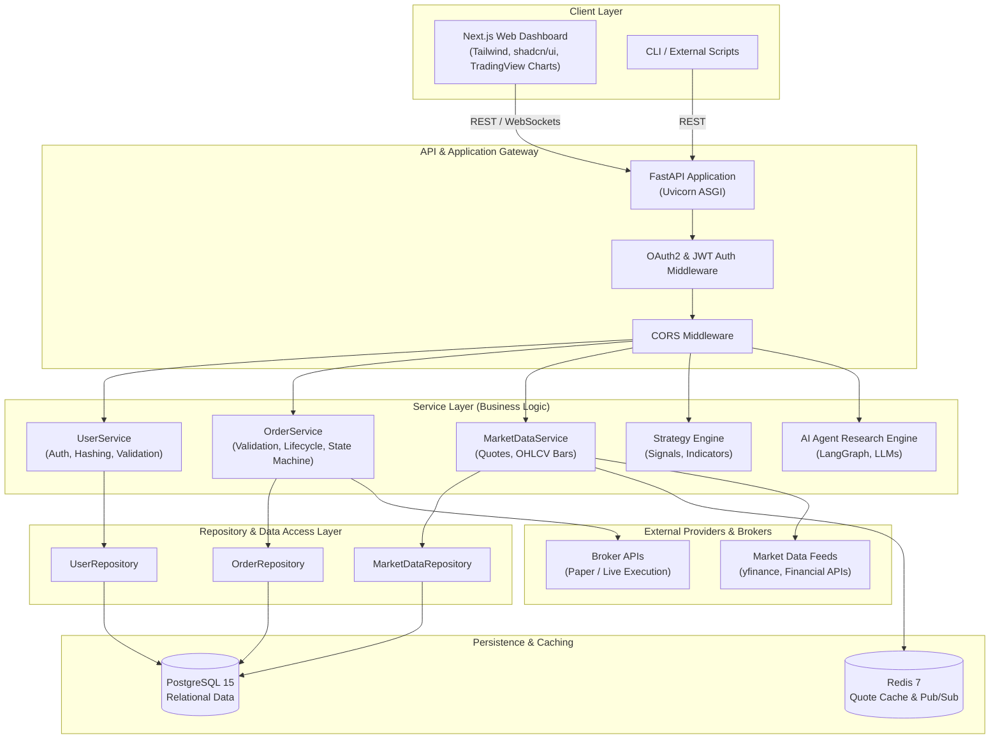
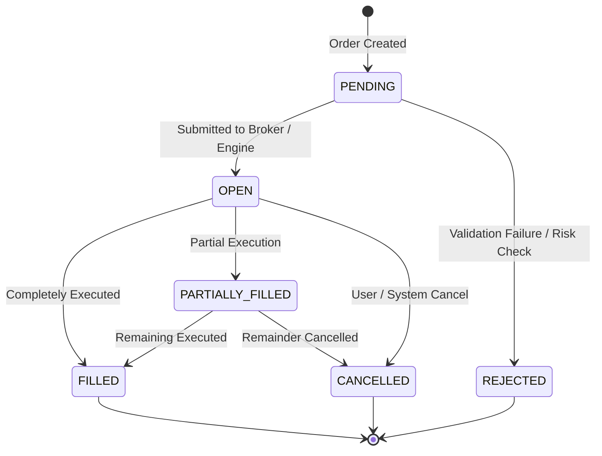
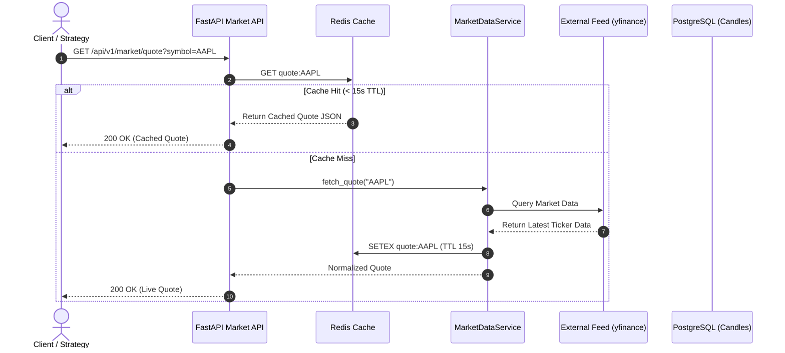

# TradePilot — Architecture & System Design

TradePilot is an algorithmic trading platform engineered for strategy backtesting, paper trading, and AI-assisted market research. The platform is designed around a clean, layered architecture emphasizing separation of concerns, deterministic execution, and modular extensibility.

---

## 1. High-Level System Architecture



---

## 2. Layered Architecture (3-Tier Pattern)

The backend follows a strict 3-tier decoupling to ensure testability and prevent business logic leaks into HTTP controllers:

```
FastAPI Endpoints (Controllers)
       │
       ▼
Service Layer (Business Rules & Orchestration)
       │
       ▼
Repository Layer (Database Queries via SQLAlchemy 2.0)
       │
       ▼
Database Models & Persistence (PostgreSQL)
```

1. **Endpoints (`app/api/v1/endpoints/`)**:
   - Handle HTTP requests, status codes, and input/output serialization via Pydantic models.
   - Do **not** contain business validation rules or direct database queries.
2. **Services (`app/services/`)**:
   - Pure Python business logic (e.g. ensuring LIMIT orders contain a price, calculating indicators, handling order state transitions).
   - Injected with repository instances.
3. **Repositories (`app/repositories/`)**:
   - Encapsulate data access with SQLAlchemy 2.0 select and execute queries.
   - Shield business logic from persistence framework details.
4. **Models & Schemas (`app/models/`, `app/schemas/`)**:
   - Declarative mapped SQLAlchemy ORM models (`app/models/`).
   - Pydantic v2 schemas (`app/schemas/`) for strict input validation and response shaping (`from_attributes = True`).

---

## 3. Order Lifecycle State Machine

Orders follow a deterministic lifecycle:



### State Definitions
- **PENDING**: Initial state upon ingestion; price, symbol, and account constraints validated.
- **OPEN**: Active order posted to the market or paper trading simulator.
- **FILLED**: Order executed in full at execution price.
- **CANCELLED**: Canceled by the trader before completion; only permitted from `PENDING` or `OPEN`.
- **REJECTED**: Rejected due to insufficient margin, invalid price parameters, or outside trading hours.

---

## 4. Security Architecture

1. **Authentication**:
   - OAuth2 Password Bearer flow.
   - Access tokens generated using HMAC-SHA256 (`HS256`) JWTs containing user ID (`sub`) and expiration timestamp (`exp`).
2. **Password Security**:
   - Passwords hashed using Argon2 (`pwdlib`) with memory and computation hardness to resist offline brute-force attacks.
3. **Authorization & Multi-Tenancy**:
   - User identity extracted per request via `get_current_user` dependency.
   - Query isolation: Users can only query, modify, or cancel orders that match their authenticated `user_id`.

---

## 5. Market Data Architecture (Phase 2)



---

## 6. Directory Structure

```text
backend/
├── alembic/              # Database migration scripts
├── app/
│   ├── api/              # API routes, dependencies, and v1 endpoints
│   │   ├── v1/
│   │   │   └── endpoints/
│   │   │       ├── health.py
│   │   │       ├── order.py
│   │   │       ├── user.py
│   │   │       └── market.py
│   │   ├── dependencies.py
│   │   └── router.py
│   ├── core/             # Configuration, logging, and security
│   │   ├── config.py
│   │   ├── logging.py
│   │   └── security.py
│   ├── db/               # Engine, Base, session dependencies
│   │   ├── base.py
│   │   ├── database.py
│   │   └── dependencies.py
│   ├── models/           # SQLAlchemy 2.0 ORM models
│   ├── repositories/     # Data access layer
│   ├── schemas/          # Pydantic v2 validation models
│   ├── services/         # Domain business logic
│   └── main.py           # FastAPI entrypoint
├── tests/                # Automated pytest test suite
├── requirements.txt
└── Dockerfile
```
